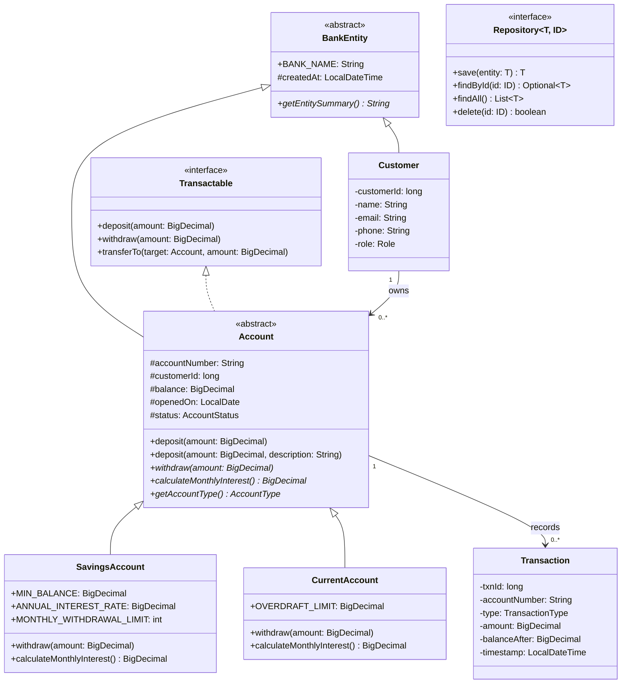
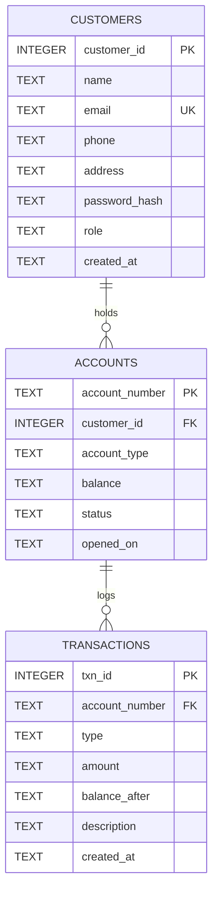

# Architecture & Design Diagrams — SRM Trust Bank

## 1. One-Page Architecture Overview

SRM Trust Bank follows a clean, layered Java architecture so that **both the JavaFX 21 desktop client and the Javalin 6 REST API share the exact same business logic and SQLite persistence layer**:

1. **Presentation Layer (`com.bank.ui`, `web/`, `com.bank.api`)**
   - **Desktop UI (`com.bank.ui`):** JavaFX 21 application (`BankingApp`) with `LoginView`, `DashboardPane`, `TransactionPane`, `StatementPane`, `AdminPane`, and `ChatbotPane`. Uses delegation listeners, `KeyPressedAdapter`, `MenuBar`/`ToolBar`, and `Platform.runLater` for async chatbot calls.
   - **Web Frontend (`web/`):** Responsive HTML/CSS/vanilla JS client calling the Javalin REST API via `fetch()`, storing HMAC-signed session tokens in `sessionStorage`, and providing a floating FAQ chatbot widget.
   - **REST Layer (`com.bank.api`):** `ApiServer` starts Javalin on `PORT` (default `7070`), enforces Bearer token authentication (`TokenUtil`) and rate limiting (`RateLimiter`), maps `BankException` subclasses to HTTP status codes (`400`, `401`, `403`, `404`, `409`), and never leaks password hashes.

2. **Service Layer (`com.bank.service`, `com.bank.ai`)**
   - `AuthService`: PBKDF2WithHmacSHA256 authentication, `HashSet` duplicate detection, RBAC (`CUSTOMER` / `ADMIN`).
   - `BankService`: Account lifecycle, deposits, withdrawals, deadlock-free atomic transfers (consistent lock ordering + SQLite `setAutoCommit(false)` commit/rollback), `HashMap` cache, `LinkedList` recent activity, `TreeMap` date statements, and `Iterator` cache cleanup.
   - `InterestService`: `Runnable` background scheduler + manual `runNow()` trigger for 3.5% p.a. savings interest.
   - `StatementService`: Stream-based TXT/CSV export and CSV import.
   - `ChatbotService`: Stateless `java.net.http.HttpClient` client for Anthropic Messages API with 10-second timeout, zero DB access, and offline FAQ fallback.

3. **Data Access & Domain Layer (`com.bank.dao`, `com.bank.model`, `com.bank.generic`, `com.bank.util`)**
   - `Repository<T, ID>` implemented by `SqliteCustomerDao`, `SqliteAccountDao`, and `SqliteTransactionDao` using parameterized `PreparedStatement` queries only.
   - `DatabaseManager` initializes SQLite (`PRAGMA foreign_keys = ON`) and seeds initial demo records on first run.

---

## 2. UML Class Diagram

---

## 3. Entity-Relationship (ER) Diagram

